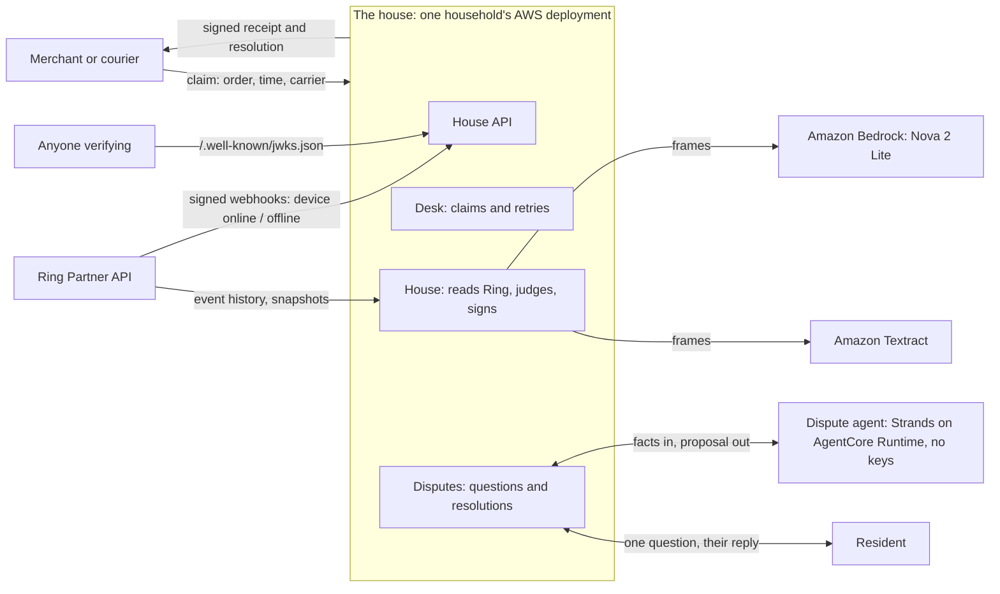
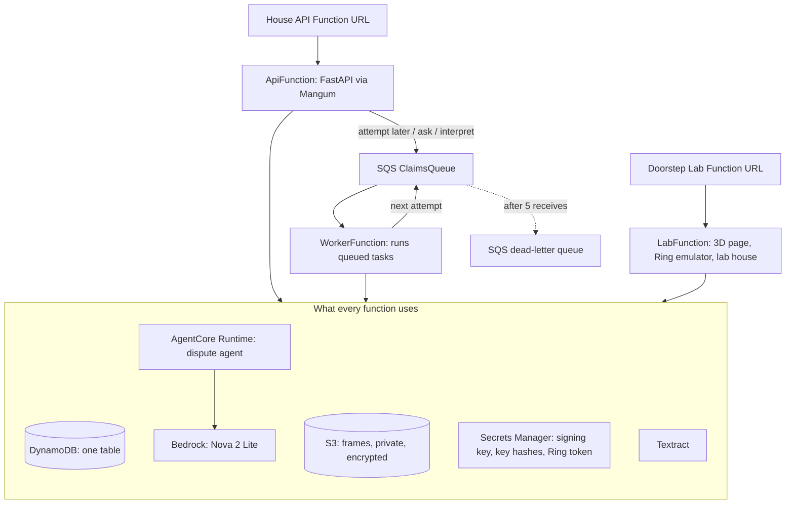
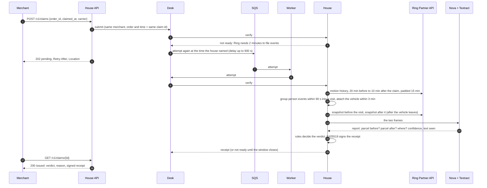
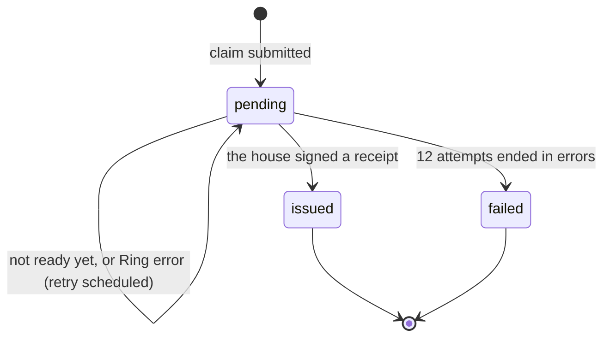
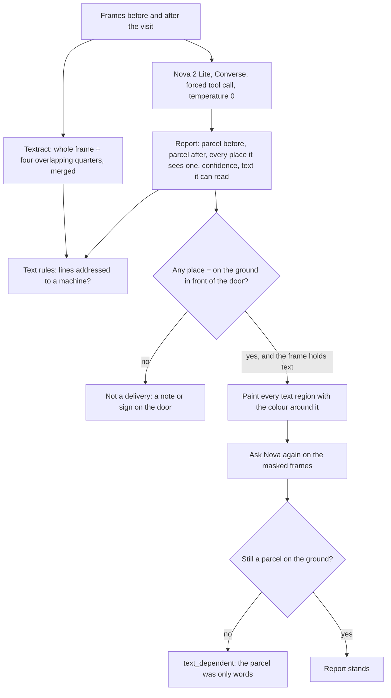
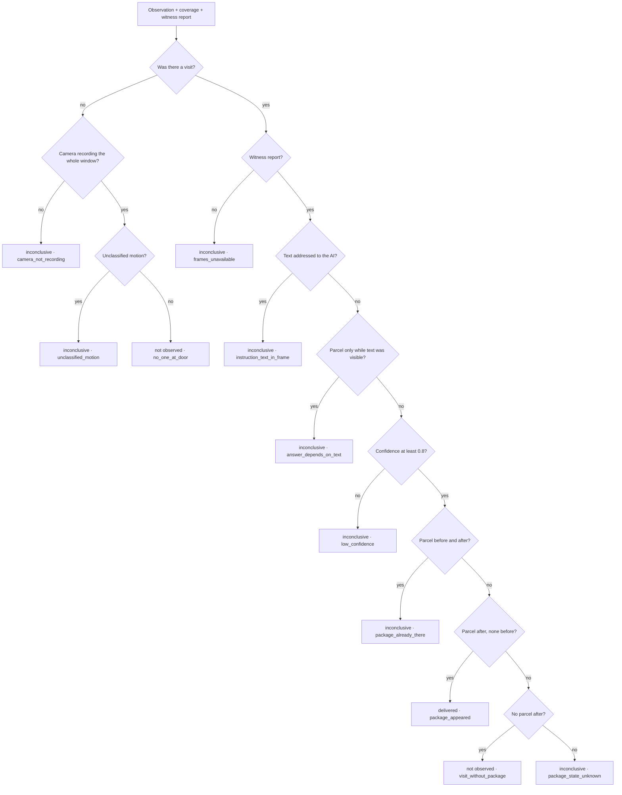
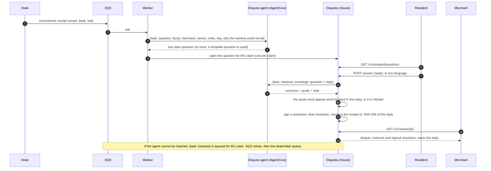
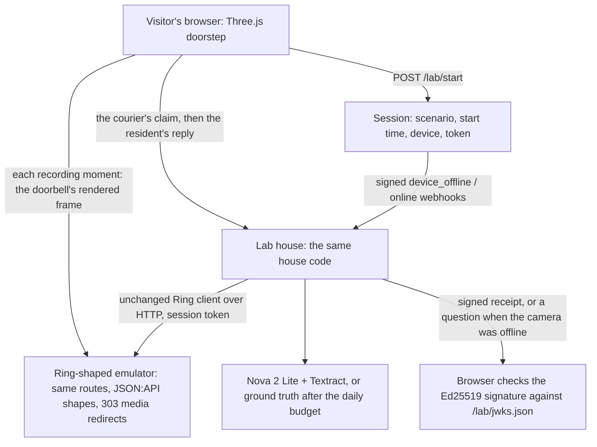

# Countersign architecture

How a delivery claim becomes a signed receipt, and how the pieces are deployed. The [README](README.md) covers what the project is and how to run it; this file covers how it works inside. Numbers here are the values in the code.

## 1. The parts

The house belongs to the household. It holds the Ring token, the frames and the Ed25519 signing key, and it is the only thing that signs. A merchant gets a receipt; anyone can check it with the house's public key. Frames never leave the house's own S3 bucket; a receipt carries their SHA-256 hashes and a per-house pseudonym for the camera, never the Ring device id.

## 2. On AWS

Everything except the agent is one CloudFormation (SAM) stack, `infra/template.yaml`: three arm64 Python 3.12 Lambdas, the queue and its dead-letter queue, the table and the bucket. The agent is deployed separately as direct code (`scripts/deploy_agent.py`), and the stack's functions may call only that runtime. Lambdas reach AgentCore with `InvokeAgentRuntime`; the agent's own role may only call Nova and write logs.

## 3. A claim, end to end

The desk tries once on arrival and then whenever the house says when to come back. A "delivered" is issued as soon as it is seen; "not observed" and "inconclusive" wait until the claim window has closed plus 2 minutes, so a late visit is not missed. An expired Ring token keeps the claim pending (retry in 5 minutes) and says why; other Ring errors retry in 2 minutes; after 12 failed attempts the claim is marked failed.

## 4. The witness: what the model may and may not decide

Nova reports; it never decides. Textract cannot be instructed, so its reading of the frame is what the text rules trust. Each source of text is scanned on its own, so lines from two frames are never joined into an instruction that neither holds.

## 5. The rules that decide

This is `verdict.decide()`, plain code. Coverage comes from Ring's `device_online` / `device_offline` webhooks: the last status before the window and every change inside it. With no history, the house uses the camera's status now and the receipt says so.

## 6. When the camera cannot settle it

The agent never sees frames, Ring ids or keys, and it never signs. The question names the day in the household's timezone.

## 7. What is stored

One DynamoDB table, keyed by `pk` and `sk`:

| Partition key | Sort key | Holds |
|---|---|---|
| `CLAIM#<claim_id>` | `CLAIM` | the claim record and its status |
| `RECEIPT#<receipt_id>` | `RECEIPT` | the signed receipt |
| `ORDER#<merchant>#<order_id>` | `<issued_at>#<id>` | receipts per order |
| `RECENT` | `<issued_at>#<id>` | receipts, newest first |
| `DEVICE#<device_id>` | `STATUS#<at_ms>` | the camera's online history, from webhooks |
| `WEBHOOK#<request_id>` | `SEEN` | webhook dedupe, expires after 7 days |
| `QUESTION#<question_id>` | `QUESTION` | a question for the resident and its resolution |
| `CLAIMQ#<claim_id>` | `QUESTION` | the claim's question id |
| `OPENQ` | `<asked_at>#<id>` | open questions, oldest first |
| `LABSESSION#<sid>` | `SESSION` | a Doorstep Lab visitor's session, expires after a day |
| `LABBUDGET#<day>` | `BUDGET` | Nova runs used by the lab today |

The lab's own house writes the same keys with a `LAB#` prefix, so lab claims and questions never reach the real resident. S3 holds evidence frames under `frames/<receipt_id>/` (kept 90 days) and everything of the lab under `lab/` (kept 1 day).

## 8. The Doorstep Lab

The lab is a simulation, built because the Ring Developer Playground cannot stage a delivery. Each visitor gets their own session, device and token, so visitors never see each other's doorstep. The lab house runs the same house code as the real one against the emulator, with Nova judging up to a daily budget of runs.

## 9. Where to look in the code

| Concern | Files |
|---|---|
| Ring client and webhooks | `countersign/ring.py`, `countersign/webhooks.py`, `countersign/tokens.py` |
| Claim window, visits, frames | `countersign/episode.py`, `countersign/house.py` |
| Witness and text guard | `countersign/witness.py`, `countersign/doorman.py` |
| Rules and receipts | `countersign/verdict.py`, `countersign/receipt.py` |
| Claims, API, storage | `countersign/desk.py`, `countersign/api.py`, `countersign/store.py`, `countersign/aws_store.py` |
| Disputes | `countersign/disputes.py`, `countersign/dispute_agent.py`, `agentcore/app.py` |
| AWS entry points | `countersign/lambda_app.py`, `countersign/lab/lambda_lab.py`, `infra/template.yaml` |
| Doorstep Lab | `countersign/lab/` |

The text guard in `countersign/doorman.py` also lives on as its own open-source library, [Doorman](https://github.com/N-45div/Doorman), generalised to any camera question and any vision model.
